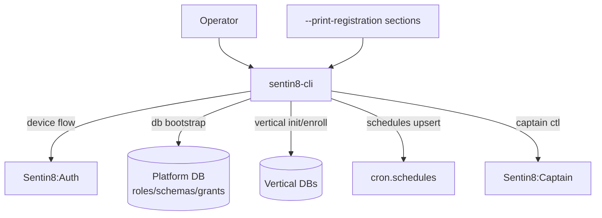

# Sentin8:CLI - Unified Operator CLI

> A **starter** - builds and boots before any service (RS §2.5). The
> CLI links no service binary (invariant RS-2); it owns the platform
> bootstrap plane (`migrations/platform.sql`) and the enrollment +
> captain control paths.

## 1. Summary

`sentin8-cli` is the operator's single entry point for platform
management: device-flow operator sign-in, database bootstrap
(roles/schemas/grants - `db bootstrap`), vertical enrollment
(composable per-repo registration - `vertical init` / `vertical
enroll` / `vertical unenroll`), and captain fleet control (`captain
start/stop/status/upgrade-instance`).

## 2. Motivation

- **One authority for bootstrap.** Roles, schemas, and grants are
  provisioned exactly once, from the repo that owns them - never by a
  service at boot.
- **Composable enrollment.** Each repo ships one
  `service-registration.json` + `catalog.json`; the CLI merges any mix
  of repo directories and legacy aggregate files into the same
  registry tables (RS §6).
- **Declarative everything.** Schedules, admin scopes, policies,
  relations, event triggers - all read from
  `--print-registration --section=…` and provisioned idempotently
  (SDD §2.4 schedules included).

## 3. Architecture & High-Level Design



## 4. Key Commands

```bash
sentin8-cli db bootstrap              # platform roles + schemas + grants
sentin8-cli vertical init <repo>      # per-repo SQL application
sentin8-cli vertical enroll <repo>…   # registry rows + catalog + schedules
sentin8-cli captain start             # spawn the fleet (via captain)
```

## 5. Notes

`migrations/platform.sql` lives here - the cluster-wide role and
platform-schema definitions the whole tree depends on. See `DESIGN.md`
for the enrollment pipeline and the SDD §2.4 schedules provisioning;
`BUSINESS.md` for the operator capability list.

---

**Design attribution:** sentin8:cli and its underlying concepts were designed by Hamid Jahanzad <Hamid@Jahanzad.com>.
